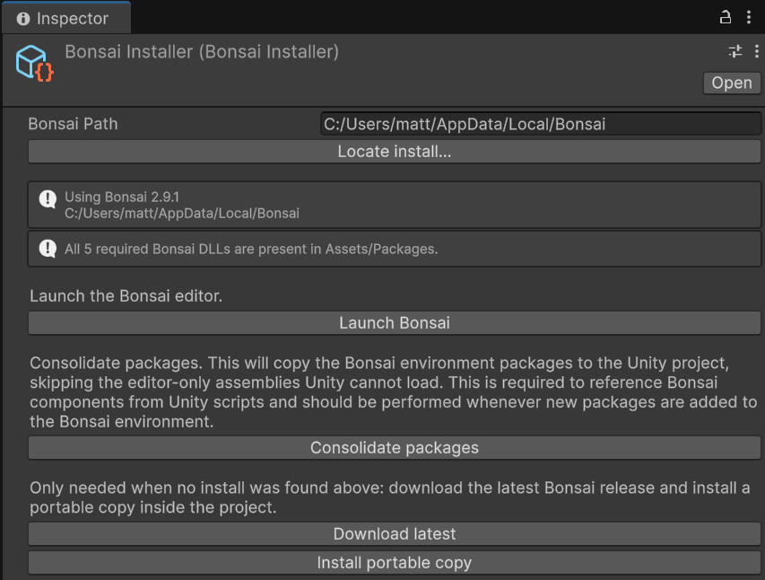

# Unity Bonsai Hooks
A Bonsai interface for the Unity real-time development platform

# Introduction
This repository contains a Unity package and minimal sample project to allow the Unity engine to interface with Bonsai workflows. This interface can be used to pass data between Unity and Bonsai at runtime and harness Bonsai reactive workflows to perform image processing tasks, integrate Arduino devices, perform machine-learning tasks etc.

Unity loads the Bonsai runtime DLLs and runs the workflow **inside its own process**. There is no network link between the two, and Unity sees each value the moment Bonsai emits it, with a timestamp taken on the same clock (`Stopwatch`, i.e. QueryPerformanceCounter on Windows).

This is a fork of the unmaintained [emotional-cities/unity](https://github.com/emotional-cities/unity), updated for Unity 6 and Bonsai 2.9 (see [Changes from upstream](#changes-from-upstream)). The sample project is in `BonsaiInterface/` (Unity 6000.6, URP).

## Start here

**Never used Unity, Bonsai or code before?** Follow [**Getting started**](docs/Getting-Started.md). It goes from installing everything to Unity reacting to your own workflow, one click at a time, and needs no programming.

| I want to... | Read |
|---|---|
| Set everything up and make my first connection | [Getting started](docs/Getting-Started.md) |
| Copy a ready-made script (move an object, react to an event, send a value, save data) | [Recipes](docs/Recipes.md) |
| Fix an error or something that doesn't work | [Troubleshooting](docs/Troubleshooting.md) |
| Look up a word | [Glossary](docs/Glossary.md) |
| See what this README covers (for people who know Unity) | [Installation](#installation), [Quick start](#quick-start), [Samples](#samples) |
| Write my own scripts against the full API (programmers) | [Hook API](docs/Hook-API.md) |
| Know the traps with hardware and workflows (programmers) | [Gotchas](docs/Gotchas.md) |
| See what could be built next (Harp, Open Ephys, cameras, no-code components...) | [Possible extensions](docs/Extensions.md) |
| Know what changed from the original package | [Changes from upstream](#changes-from-upstream) |

## Requirements

| | Version |
|---|---|
| Windows | 10 or 11, 64-bit (Bonsai is Windows-only) |
| Unity | 6000.6.0f1 for the sample project. The package itself is plain C# and should work in other Unity 6 versions (not tested). |
| Bonsai | 2.9.2, the same version on every computer |

# Installation
To try the interface, open the sample project (`BonsaiInterface/`) in Unity Hub; [Getting started](docs/Getting-Started.md#4-get-this-project) shows how.

To add it to **your own** Unity project, copy the folder `BonsaiInterface/Assets/Bonsai` into your project's `Assets` folder, including the `.meta` files (copy it in File Explorer while Unity is closed, or drag it into Unity's Project window), and nothing else: the samples are in `Assets/Samples`, which you don't need. There is currently no up-to-date `.unitypackage` release; older releases of the upstream package predate the changes below.

| Folder (in `Assets/Bonsai`) | Contents |
|---|---|
| `Runtime/` | `BonsaiWorkflow`, `BonsaiDispatcher`, `BonsaiWorkflowAsset`, `UnitySignal`: the runtime. They need the Bonsai DLLs. |
| (top level) | The `BonsaiInstaller` asset. |
| `Editor/` | `BonsaiEditorMenu`: the **Bonsai** menu. Editor-only, so player builds don't include it. |
| `Installer/` | `BonsaiInstaller` and its inspector, `BonsaiDllCheck`. In their own Editor-only assembly with no Bonsai references, so they compile even before any Bonsai DLL is in the project. |
| `RequiredDlls.txt` | The DLLs your workflows need (see [Checking the DLLs](#checking-the-dlls)). |

> :warning: The project doesn't ship `Bonsai.Core.dll`, so the first time you open it Unity reports compile errors and asks whether to enter **Safe Mode**.
> Choose **Ignore** (or click **Exit Safe Mode** if it already opened in Safe Mode) and continue with the steps below; consolidating the packages resolves the errors.

Once the import has completed, navigate to the Bonsai folder in Assets and locate the 'BonsaiInstaller' asset. Click on the asset to open the custom inspector. If Bonsai is already installed on the system it is detected automatically, and you can go straight to **Consolidate packages**. Otherwise, use the download and install steps at the bottom of the inspector first.



- **Bonsai Path** shows the install the interface will use. It is filled in automatically from the first install found: a path set here, then `%LOCALAPPDATA%\Bonsai`, then `%ProgramFiles%\Bonsai`, then a portable copy inside the project. Type a path or use **Locate install...** to pin a specific install; clear the field to search again.
- The box under it reports the [DLL check](#checking-the-dlls): all present, missing (red) or a different version (yellow).
- **Launch Bonsai** opens the Bonsai editor for the install shown above.
- **Consolidate packages** copies the libraries required to run a Bonsai process from a Unity instance out of the Bonsai environment and into `Assets/Packages`. Editor-only assemblies (Bonsai.Editor, Bonsai.Design and anything built on it, WebView2, DockPanelSuite, ScintillaNET) are skipped, since Unity cannot load them. Perform this step after importing any new packages in the Bonsai editor.
- Packages with **known compatibility problems** in Unity (`Bonsai.BonVision`, `Bonsai.VR`, `Bonsai.Audio`, `Bonsai.Shaders` and their sub-assemblies) are **not copied**: Consolidate packages logs an error for each and lists them in the completion dialog. If a workflow needs one, put the DLL in `Assets/Packages` by hand; nothing already there is deleted automatically. The list is `KnownProblemAssemblies` in `BonsaiInstallerEditor.cs`.
- **Download latest** and **Install portable copy** are only needed when no install was found. They fetch the most recent Bonsai release and set up a portable environment in the root project folder. Close the Bonsai editor after the install step to complete it.

Keep one Bonsai version on every machine: a workflow saved by a newer Bonsai can fail to load against an older `Bonsai.Core.dll`. `Assets/Packages` is not in git, so each clone consolidates its own copy.

## Caveats

- **Windows only**, 64-bit. Bonsai doesn't run elsewhere.
- **First open shows compile errors and a Safe Mode prompt** until the Bonsai DLLs are consolidated (see above).
- **The Input System package is required by the samples.** The sample project uses `com.unity.inputsystem` with **Active Input Handling** set to the new handler. Your own project needs the package if you copy a script that reads `Keyboard.current`; legacy `Input.GetKey...` throws when only the new handler is active.
- **One Bonsai version on every machine.** A workflow saved by a newer Bonsai can fail to load against an older `Bonsai.Core.dll`.
- **Some packages don't work inside Unity.** `Bonsai.BonVision`, `Bonsai.VR`, `Bonsai.Audio` and `Bonsai.Shaders` are skipped by Consolidate packages. Nodes that need a Windows message loop, such as `KeyDown`, never fire ([Gotchas](docs/Gotchas.md#keydown-never-fires-inside-unity)).
- **Nested workflows can't be hooked.** Only `GroupWorkflow` contents are reachable, through `groupPath`; `SelectMany` and `CreateObservable` inner workflows are not.
- **Auto Start is the only way to start a workflow.** `HoldStart`/`ReleaseStart` can delay it, but a stopped workflow can't be restarted until you leave and re-enter Play.
- **Player builds are untested.** The build check blocks missing DLLs, but whether a built player runs a workflow hasn't been verified, and the IL2CPP scripting backend will likely fail (Bonsai builds workflows at runtime). Use **Mono**. See [Possible extensions](docs/Extensions.md#a12-built-players).
- **Workflow assets are snapshots.** After editing a `.bonsai` file, refresh the asset with **Bonsai › Create Bonsai workflow asset › Overwrite**.

## Checking the DLLs

A missing DLL does **not** stop a workflow from loading. Bonsai loads every node from a missing assembly as a *proxy* with the same type name and no properties, so the workflow starts and those nodes silently do nothing. `BonsaiDllCheck` compares `Assets/Packages` with `Assets/Bonsai/RequiredDlls.txt`:

| When | Missing DLL | Different version |
|---|---|---|
| Scripts reload | Warning | Warning |
| Entering Play mode | Error | Warning |
| Player build | Build fails | Warning |
| BonsaiInstaller inspector | Red box | Yellow box |

Each line of `RequiredDlls.txt` is `<dll> <version> <comment>`, with versions as `major.minor.build`. The shipped list covers the samples (`Bonsai.Core` and the four `System.Reactive` DLLs). When your workflow uses another Bonsai package, add its DLL and anything it references that isn't part of .NET or Unity.

# Quick start

This is the short version for people who already use Unity and Bonsai. [Getting started](docs/Getting-Started.md) covers the same steps in full detail. It assumes you have already consolidated the packages (see [Installation](#installation) and the [caveats](#caveats)); until then Unity shows compile errors and offers Safe Mode.

As a quick minimal example, we'll create a Bonsai workflow with a periodic timer that emits events every second, and then log those events to the Debug window in Unity.

Click **Launch Bonsai** and create a new Bonsai project. Add a timer node with a period of 1s. Connect the timer to a PublishSubject node and give it a name like 'TimerOutput'. Save the workflow in the assets folder of your Unity project (as e.g. timer-test.bonsai).


In the Unity editor, locate the Bonsai menu (located with File, Edit etc.) and select **Create Bonsai workflow asset**, then pick the `.bonsai` file. This saves the workflow as a scriptable object named `timer-test.bonsai.asset` next to the file (or in `Assets/` if the file is outside the project), which can be dragged into the Unity inspector later.

The asset is a **snapshot**, not a link. After editing the workflow in Bonsai, run the menu item again and choose **Overwrite**; the asset is updated in place and keeps its GUID, so scenes that use it keep their reference.

Create a new empty game object in the Unity scene hierarchy and add the 'BonsaiWorkflow' component. In the 'BonsaiWorkflowAsset' field drag in the newly created scriptable object from assets, and tick **Auto Start**. Auto Start is currently the only way to start a workflow.


Create a new script called 'WorkflowMonitor' on the same empty game object and add the code:

```csharp
using UnityEngine;
using Bonsai.Reactive;

public class WorkflowMonitor : MonoBehaviour
{
    void Awake()
    {
        var workflow = GetComponent<BonsaiWorkflow>();

        workflow.InjectSubscription("TimerOutput",
                                    typeof(PublishSubject),
                                    value => { Debug.Log(value); });
    }
}
```

Hit play in the Unity editor and you should see the timer output logged to the Console.

This is a very minimal example but demonstrates the basic workflow for using the Bonsai interface.

- First a workflow is created with some data that we want to pass to Unity. Generally it is useful to expose this data with a Subject like PublishSubject so that we can explicitly name the data sequence, but any top-level node can be linked to in Unity.
- The workflow is saved and converted to a scriptable object, which can then be used by a game object with the 'BonsaiWorkflow' component. This component parses the workflow in `Awake` and, with Auto Start on, builds and starts it in `Start`.
- Other Unity scripts interact with the workflow via the `InjectSubscription` method of the 'BonsaiWorkflow' component. This method takes the node's name and its **exact** type to locate the node, as well as an Action that defines what Unity should do with data that arrives from it (in this case just log the value to the console). The Action runs on Unity's main thread.
- Register in **`Awake`**, not `Start`: the workflow starts in `BonsaiWorkflow.Start`, and Unity doesn't order different components' `Start` calls, so a hook registered in `Start` may arrive too late and be ignored.

`typeof(PublishSubject)` here is `Bonsai.Reactive.PublishSubject`, the type current Bonsai saves. Files saved by Bonsai 2.6/2.7 load as the obsolete `Bonsai.Expressions.PublishSubjectBuilder` instead; re-save them in a current Bonsai and refresh the asset. [docs/Hook-API.md](docs/Hook-API.md#which-type-to-pass) has the full table.

Other hooks let Unity feed values into the workflow, replace a source node, override a node property, delay the start, and read when each value was emitted. They are all described in [docs/Hook-API.md](docs/Hook-API.md).

# Samples

The project in `BonsaiInterface/` has four sample scenes. **Start with `Samples/Scenes/HooksDemo`**: it exercises every hook in one place. Press Play, click **Start**, then use the slider, letter keys and Space, and watch the LED and the on-screen log. The header of `HooksDemo.cs` maps each hook to its workflow node. Consolidate packages first (see [Installation](#installation)).

Everything sample-only is in `BonsaiInterface/Assets/Samples`: scenes in `Samples/Scenes/`, scripts in `Samples/Scripts/`, workflows (each `.bonsai` file and its `.bonsai.asset`) in `Samples/Workflows/`. The package itself is `Assets/Bonsai`. Keyboard input in the samples uses the Input System package (`com.unity.inputsystem`, already in the project's `Packages/manifest.json`), with **Active Input Handling** set to **Input System Package (New)**; see the [key recipe](docs/Recipes.md#stop-the-workflow-with-a-key) if your own project differs.

| Scene | Workflow | Script | What it shows |
|---|---|---|---|
| `Samples/Scenes/HooksDemo` | `hooks-demo.bonsai`: a 1 s blink (`LedOn` → `Delay LedOnTime` → `LedOff`), a typed `UnityKey` subject echoed to `KeyEcho`, `SliderInput → FloatProperty → SliderEcho`, and a group `TrialTrigger` whose 3 s `Timer` feeds `Trigger` | `HooksDemo` | Every hook: `HoldStart`/`ReleaseStart`, `SetNodeProperty` (blink period), `GetExternalizedTimeSpan`, `InjectSubscription` and `InjectImmediateSubscription` (LED sphere), `SendToSubject` (keys), `InjectInput` (slider), `ReplaceSource` with `groupPath` (Space replaces the timer), `StopWorkflow`. Uses only `Bonsai.Core`. For a real LED, add an Arduino `DigitalOutput` after `LedOn`/`LedOff` in Bonsai. |
| `Samples/Scenes/SampleScene` | `timer-workflow.bonsai`: `Timer(1 s) → Take(10) → PublishSubject TimerOutput`, plus a `SubscribeSubject TimerOutput` | `WorkflowSubscriber` | Bonsai to Unity. Logs the ten timer values and how long each took to reach the main thread. The two nodes named `TimerOutput` show why the type argument matters. |
| `Samples/Scenes/InputTest` | `input-test.bonsai`: `ExternalizedMapping IntInput → IntProperty → PublishSubject IntValue` (and the same for float) | `InputInjector` | Unity to Bonsai and back. Feeds the frame count into `IntInput` with `InjectInput`, and logs what `IntValue` emits. `IntegerSource` is the pattern for any Unity-driven source, including one for `ReplaceSource`. |
| `Samples/Scenes/ArduinoBlink` | `arduino-blink.bonsai`: `Timer(0.5 s)` → even-tick `ExpressionTransform` → `CombineLatest` with the typed `BlinkEnabled` subject → `DigitalOutput` (pin 13); the same timer feeds `TimeInterval` → Hz → `PublishSubject BlinkRate` | `ArduinoBlink` | Unity and a real Arduino, both ways. **Space** sends `true`/`false` into `BlinkEnabled` (`SendToSubject`) to start and stop the built-in LED, and Bonsai's measured blink rate comes back to the Console (`InjectSubscription`). The Inspector sets the blink period (`SetNodeProperty`); the Arduino connection (`CreateArduino`) is configured in the workflow. Needs an Arduino running StandardFirmata and the Bonsai Arduino and Scripting.Expressions packages consolidated; see [Arduino blink setup](#arduino-blink-setup). |

## Arduino blink setup

1. Upload **StandardFirmata** to the board (Arduino IDE: **File › Examples › Firmata › StandardFirmata**), then close the Arduino IDE and its Serial Monitor; they hold the port.
2. In Bonsai, install **Bonsai - Arduino Library** and **Bonsai - Scripting Expressions** (**Manage packages**), close Bonsai, then select `Assets/Bonsai/BonsaiInstaller` in Unity and click **Consolidate packages**. If either DLL is missing, the scene logs an error at Play instead of silently doing nothing.
3. Open `arduino-blink.bonsai` in Bonsai and set the **CreateArduino** node's **PortName** (Windows Device Manager › Ports) and **BaudRate** (it must match the rate the board's Firmata sketch was built with; StandardFirmata's default is 57600), then save. `DigitalOutput` refers to that connection by the node's **Name**. Open `Samples/Scenes/ArduinoBlink`, select the **ArduinoBlink** object: **Blink Period Seconds** sets the full on-and-off cycle.
4. Press Play, wait about 2 seconds (opening the port resets the Arduino), then press **Space** in the Game view to start and stop the built-in LED. The Console shows `Blink rate: 1.0 Hz (measured by Bonsai)` while it blinks.

**Without Unity:** open `arduino-blink.bonsai` in Bonsai, check the `CreateArduino` node's **PortName**, press **F5**, then press **Space**. The `KeyDown` node (a Windows keyboard hook, so it reacts to Space whichever window has focus) feeds an `ElementIndex` toggle that drives `BlinkEnabled`: the first press starts the blinking and the second stops it. Inside Unity `KeyDown` never fires ([Gotchas](docs/Gotchas.md#keydown-never-fires-inside-unity)), so the scene's Space key sends `BlinkEnabled` instead, and that part of the workflow stays idle.

How it works: the workflow's `Timer` ticks once per half cycle and the LED is on for even ticks while `BlinkEnabled` is true. Bonsai measures the time between ticks and publishes the rate to `BlinkRate`. The measurement jitters by a few percent, so the script logs it to one decimal and only when it changes. The timer's period is set from the Inspector before the workflow starts. To let Unity change the rate while running, externalize the `Timer`'s `Period` and drive it with `InjectInput` (the header of `ArduinoBlink.cs` has the outline).

The workflow was run headless in Bonsai 2.9.1 with the Arduino replaced by a file writer, which showed the LED alternating and the rate near 1 Hz. It hasn't been run against a physical board.

# Changes from upstream

Changes from [emotional-cities/unity](https://github.com/emotional-cities/unity), made while using the interface in an experiment rig (Unity 6, Bonsai 2.9.1, Arduino).

| Change | Why |
|---|---|
| The graph is wrapped in inspectable builders **once** | Wrapping twice hid subjects from the build context: `No valid build context was provided`. |
| `SubscribeSubjectBuilder` replaced for Unity 6 / Bonsai 2.9 | It is deprecated. |
| Installer finds the system install first, skips editor-only assemblies, fixes a WebView2 name clash | So **Consolidate packages** produces a set Unity can load. |
| Installer skips packages with known Unity problems | They are not copied and each logs an error; nothing already in `Assets/Packages` is deleted. |
| Installer, its inspector and the DLL check moved to an Editor-only assembly with no references | With everything in one assembly, a fresh clone (no DLLs) failed to compile, so the installer that fixes it was unreachable. Keep `Installer/` free of `Bonsai.*` references. |
| `BonsaiEditorMenu` moved to `Editor/` | It uses `UnityEditor`, which broke player builds. |
| New: `BonsaiDllCheck` + `RequiredDlls.txt` | A missing DLL silently turns nodes into proxies that do nothing; now it warns, errors at Play, and blocks builds. |
| Asset menu: handles Cancel, writes next to the `.bonsai` file, **Overwrite** updates in place | Upstream threw on Cancel and refused to replace an existing asset; recreating it would change its GUID and break scene references. |
| `OnDestroy` no longer throws when the workflow never started; new `StopWorkflow()` | Disposing a null subscription threw a `NullReferenceException`. |
| `BonsaiDispatcher` clears its queue, and `BonsaiWorkflow` its registered hooks, when Play starts again | With *Enter Play Mode Options* skipping the domain reload, old callbacks were delivered to the new session and every hook was applied twice. |
| Workflow errors are logged with `Debug.LogError` | They were plain `Debug.Log` lines and easy to miss. |
| New hooks: timestamped `InjectSubscription`, `InjectImmediateSubscription`, `SendToSubject` with `UnitySignal`, `ReplaceSource`, `SetNodeProperty`, `HoldStart`/`ReleaseStart`, `GetExternalizedTimeSpan`, and an optional `groupPath` to reach nodes inside groups | See [docs/Hook-API.md](docs/Hook-API.md). |
| Samples use the Input System package instead of the legacy `Input` class | The project's Active Input Handling is the new handler. |
| `InjectInput` resolves its target when the workflow starts | It looked the node up immediately, so it failed unless `BonsaiWorkflow.Awake` happened to run first. It can now be called from `Awake` like the other hooks. |
| Samples re-saved for Bonsai 2.9, register in `Awake`, scenes have Auto Start on | The scenes predated Auto Start, so it loaded as off and neither sample ran; the scripts used the obsolete `PublishSubjectBuilder`. |
| XML documentation on every class and public member | |
