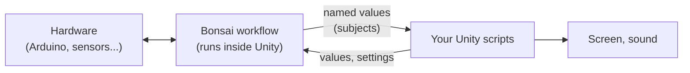

# Getting started

[README](../README.md) › Getting started

This guide takes you from nothing installed to Unity reacting to a Bonsai workflow you made yourself. It assumes you have never used Unity or Bonsai and have never programmed. Follow the steps in order; each one says what you should see when it worked. If something looks different, stop and check [Troubleshooting](Troubleshooting.md).

Words in *italics* the first time they appear are explained in the [Glossary](Glossary.md).

Allow about an hour the first time, most of it waiting for installs.

## Contents

1. [What you need](#1-what-you-need)
2. [Install Bonsai](#2-install-bonsai)
3. [Install Unity](#3-install-unity)
4. [Get this project](#4-get-this-project)
5. [Open the project in Unity](#5-open-the-project-in-unity)
6. [Copy Bonsai's files into Unity](#6-copy-bonsais-files-into-unity)
7. [Run a sample to check everything works](#7-run-a-sample-to-check-everything-works)
8. [Make your own workflow in Bonsai](#8-make-your-own-workflow-in-bonsai)
9. [Find the workflow in Unity](#9-find-the-workflow-in-unity)
10. [Put the workflow in a scene](#10-put-the-workflow-in-a-scene)
11. [Make Unity react to the workflow](#11-make-unity-react-to-the-workflow)
12. [When you change the workflow](#12-when-you-change-the-workflow)
13. [Moving to another computer](#13-moving-to-another-computer)

## How the pieces fit together

- **Bonsai** is a program for building experiments by connecting boxes (*nodes*) into a diagram (a *workflow*). It is good at talking to hardware: Arduinos, cameras, sensors, reward pumps.
- **Unity** is a program for making 3D scenes and games. It is good at showing things on screen and playing sounds.
- **This package** lets Unity run a Bonsai workflow *inside Unity itself*. You don't open Bonsai while the experiment runs. Unity hears every value Bonsai produces, at the moment it is produced.



You still use the Bonsai program to **build and edit** workflows. Unity only **runs** them.

## 1. What you need

| Item | Version | Notes |
|---|---|---|
| A Windows 10 or 11 computer | 64-bit | Bonsai only runs on Windows. |
| Bonsai | 2.9.2 | Free, from [bonsai-rx.org](https://bonsai-rx.org/docs/articles/installation.html). |
| Unity Hub | any recent | Free, from [unity.com/download](https://unity.com/download). It installs and opens Unity. |
| Unity Editor | **6000.6.0f1** | Installed through Unity Hub in step 3. Use exactly this version for the sample project. |
| A Unity account | | Free. Unity Hub asks you to sign in. |
| About 15 GB of free disk space | | Mostly for Unity. |

Use the **same Bonsai version on every computer** that runs your project. A workflow saved by a newer Bonsai can fail to open in an older one.

## 2. Install Bonsai

1. Go to [bonsai-rx.org/docs/articles/installation.html](https://bonsai-rx.org/docs/articles/installation.html).
2. Click **Download Installer (.exe)**.
3. Run the downloaded file and accept the defaults. The installer also installs anything Windows needs to run Bonsai.
4. Open **Bonsai** from the Windows Start menu. The Bonsai start screen opens.
5. On the start screen, click **Manage packages**. A window lists packages (add-ons). If you are asked to install the **Starter Pack**, do so; it contains the common nodes.
6. Close the package window, then close Bonsai.

**It worked if:** Bonsai opens from the Start menu. The installer puts Bonsai in `%LOCALAPPDATA%\Bonsai` (paste that into the File Explorer address bar to see it); this package finds it there by itself.

## 3. Install Unity

1. Go to [unity.com/download](https://unity.com/download), download **Unity Hub**, install it and open it.
2. Sign in, or create a free account, when Hub asks.
3. If Hub offers to install the latest Unity Editor, **skip** it. You will install the exact version the project needs in step 5.

## 4. Get this project

Until the Unity 6 work is merged, it lives on the `dev-unity6` branch.

1. Go to [github.com/DeepBio-Analytics/Unity-Bonsai-Hook](https://github.com/DeepBio-Analytics/Unity-Bonsai-Hook).
2. Click the branch button (it says **main**) above the file list and choose **dev-unity6**.
3. Click the green **Code** button, then **Download ZIP**.
4. Right-click the downloaded ZIP and choose **Extract All...**. Extract it somewhere simple, such as `C:\Projects\`.

You now have a folder such as `C:\Projects\Unity-Bonsai-Hook-dev-unity6\`. The Unity project is the **`BonsaiInterface`** folder inside it.

> If you use Git: `git clone -b dev-unity6 https://github.com/DeepBio-Analytics/Unity-Bonsai-Hook.git` does the same.

## 5. Open the project in Unity

1. In Unity Hub, click **Projects** on the left, then **Add** (top right) › **Add project from disk**.
2. Select the **`BonsaiInterface`** folder (not the folder above it) and click **Open** or **Add Project**.
3. The project appears in the list. If a warning says the editor version **6000.6.0f1** is missing, click it and choose **Install**. Wait for the install to finish (this can take a while).
4. Click the project name to open it. The first opening takes several minutes.
5. **Unity will ask whether to enter Safe Mode. This is expected.** The project doesn't include `Bonsai.Core.dll` yet (it is copied in at step 6), so the scripts can't compile and Unity reports compile errors. In the **Enter Safe Mode?** window, click **Ignore** to open the project normally. Do **not** click **Enter Safe Mode**.
   - If the project has already opened in Safe Mode, click **Exit Safe Mode** in the Editor's top bar to leave it. Unity reports the same compile errors again; that is fine.
   - Don't try to fix the errors yourself. Go on to step 6; consolidating the packages removes them.

**What you will see:** the Unity Editor, with these windows. Their names are used throughout this guide:

| Window | Where (default layout) | What it is for |
|---|---|---|
| **Hierarchy** | left | The objects in the open scene |
| **Scene** / **Game** | middle | The 3D view; **Game** shows what the player sees |
| **Inspector** | right | Settings of whatever is selected |
| **Project** | bottom | The files of your project (`Assets` folder) |
| **Console** | bottom, tab next to Project | Messages and errors. If you can't see it: **Window › General › Console** (Ctrl+Shift+C) |
| Play button ▶ | top centre | Starts and stops the scene |

**Messages in the Console now are expected:** a yellow warning that says `Missing Bonsai DLLs in Assets/Packages` means Unity doesn't have Bonsai's files yet. Step 6 fixes it. Red errors that mention `Bonsai` or `System.Reactive` (the ones that triggered the Safe Mode prompt) mean the same thing.

> **Screenshot to add:** `Images/unity-windows.png`: the Unity Editor with the Hierarchy, Scene, Inspector, Project and Console windows labelled.

## 6. Copy Bonsai's files into Unity

Unity needs a copy of Bonsai's program files (*DLLs*). This step is called **Consolidate packages**. You repeat it every time you install a new package in Bonsai, and on every new computer.

1. In the **Project** window, click the **Assets** folder, then double-click the **Bonsai** folder.
2. Click the file **BonsaiInstaller** (its icon is a small cube). Click it once; don't double-click.
3. Look at the **Inspector**. It shows:
   - **Bonsai Path**: the Bonsai install it found, for example `C:\Users\you\AppData\Local\Bonsai`.
   - A box saying **Using Bonsai 2.9.2**.
   - A red box saying some Bonsai DLLs are missing. That is expected right now.
4. Click **Consolidate packages**. Wait until a window says **Package consolidation complete**, then click **OK**.
5. Wait for Unity to finish loading the new files (a progress bar may show in the bottom right).

**It worked if:** the red box in the Inspector becomes a plain information box that says **All 5 required Bonsai DLLs are present in Assets/Packages**, and a new folder **Packages** appears under **Assets** in the Project window. Clear the Console (**Clear** button at the top of the Console) and check no red errors come back.

**If Bonsai Path is empty:** Bonsai isn't installed where the package looks. Go back to step 2, or click **Locate install...** and choose the folder that contains `Bonsai.exe`.

> **Screenshot to add:** `Images/installer-consolidated.png`: the BonsaiInstaller Inspector after a successful consolidation.

## 7. Run a sample to check everything works

1. In the **Project** window, open **Assets › Samples › Scenes** and double-click **SampleScene**.
2. Open the **Console** and click **Clear**.
3. Press the **Play** button ▶ at the top of the window. It turns blue.
4. Watch the Console. One message appears per second, ten in all:
   `TimerOutput 0 (delivered 3.2 ms after Bonsai emitted it)`, then `TimerOutput 1 ...`, up to `TimerOutput 9`.
5. Press **Play** again to stop.

**It worked if:** you saw ten `TimerOutput` lines. The workflow `timer-workflow.bonsai` (in **Assets › Samples › Workflows**) ran inside Unity, and a small script (`WorkflowSubscriber`, in **Assets › Samples › Scripts**) printed each value. The number of milliseconds varies; it is how long Unity took to receive the value.

There are more samples in **Assets › Samples › Scenes**. **ArduinoBlink** drives a real Arduino and needs extra setup, described in the [README](../README.md#arduino-blink-setup).

The sample **InputTest** sends a number *from* Unity *into* Bonsai and prints what comes back: a fast-growing count in the Console.

## 8. Make your own workflow in Bonsai

You will make a workflow that produces a number every second and gives that stream of numbers a name, so Unity can find it. The named stream is called a *subject*.

1. Open **Bonsai** from the Start menu and click **New Project** (or press Ctrl+Shift+N). An empty workflow opens.
2. On the left is the **Toolbox**. Click its search box and type `Timer`. Double-click **Timer** in the results. A **Timer** box appears on the workflow.
3. With **Timer** selected, look at the **Properties** panel on the right. Set **Period** to `00:00:01` (one second).
4. Click the **Timer** box so it is selected. In the Toolbox search box, type `PublishSubject` and double-click **PublishSubject**. It appears connected after Timer (an arrow from Timer to it).
   - If it isn't connected, drag the **Timer** box onto the **PublishSubject** box to connect them.
5. Select **PublishSubject**. In **Properties**, set **Name** to `MyNumbers`. The box now shows `MyNumbers`. Spelling and capitals matter: Unity finds the subject by this exact name.
6. Press **F5** to try it in Bonsai. Double-click the `MyNumbers` box: a small window shows 0, 1, 2, ... counting up. Press **Shift+F5** to stop.
7. Press **Ctrl+S** to save. Browse to your Unity project's **Assets** folder (for example `C:\Projects\Unity-Bonsai-Hook-dev-unity6\BonsaiInterface\Assets`) and save as `my-workflow.bonsai`.
8. Close Bonsai, or at least stop the workflow (Shift+F5). Unity will run the workflow from now on.

> **Screenshot to add:** `Images/bonsai-my-numbers.png`: the Timer → MyNumbers workflow in the Bonsai editor with the Properties panel showing Name.

**Rule:** only nodes on the **main level** of the workflow can be reached from Unity. If you put `MyNumbers` inside a group (a box you can double-click to open), Unity can't see it.

## 9. Find the workflow in Unity

Click back into Unity. Because you saved the file inside **Assets**, Unity has already picked it up: in the **Project** window, **my-workflow.bonsai** appears in **Assets**, with **my-workflow.bonsai.asset** next to it. The `.asset` is the *workflow asset* you give to Unity, and Unity rewrites it every time you save in Bonsai. Nothing else is needed.

If it isn't there, check that you saved into the **Assets** folder of the project Unity has open. A workflow saved anywhere else is invisible to Unity.

## 10. Put the workflow in a scene

A *scene* is one level or screen in Unity. You will make a new one so the samples stay untouched.

1. **File › New Scene**, choose **Basic (URP)** (or the first template), click **Create**. Then **File › Save As...**, save it in **Assets** as `MyScene`. (Keep it out of **Samples** so your work stays separate from the samples.)
2. In the **Hierarchy**, click **+** (top left) › **Create Empty**. An object called **GameObject** appears.
3. With it selected, find the name field at the top of the **Inspector** and rename it `Bonsai`. Press Enter.
4. In the Inspector, click **Add Component**, type `Bonsai Workflow` and click it.
5. The **Bonsai Workflow** component has two settings:
   - **Bonsai Workflow Asset**: drag **my-workflow.bonsai.asset** from the Project window onto this field.
   - **Auto Start**: **tick it.** Without it the workflow never runs.
6. **File › Save** (Ctrl+S).

> **Screenshot to add:** `Images/bonsai-workflow-component.png`: the Bonsai Workflow component with the asset assigned and Auto Start ticked. (`Images/BonsaiWorkflowComponent.PNG` is an older version.)

If you press Play now, the workflow runs, but nothing visible happens: Unity isn't listening yet.

## 11. Make Unity react to the workflow

Unity listens to a subject through a short *script*. You don't need to understand it; copy it exactly.

1. In the **Project** window, click the **Assets** folder.
2. Right-click an empty area of the Project window › **Create › Scripting › MonoBehaviour Script**.
3. A new file appears with its name selected. Type `ShowBonsaiValue` and press Enter. The name must match exactly, with the same capitals and no spaces.
4. Double-click **ShowBonsaiValue**. It opens in a code editor (Visual Studio or VS Code, whichever is installed; if Unity asks which, pick either).
5. Select **all** the text (Ctrl+A) and delete it. Paste this instead:

   ```csharp
   using UnityEngine;

   [RequireComponent(typeof(BonsaiWorkflow))]
   public class ShowBonsaiValue : MonoBehaviour
   {
       // The Name you gave the PublishSubject in Bonsai. Change it in the Inspector.
       public string subjectName = "TimerOutput";

       private string latestValue = "(nothing yet)";

       void Awake()
       {
           var workflow = GetComponent<BonsaiWorkflow>();
           workflow.InjectSubscription(subjectName, typeof(Bonsai.Reactive.PublishSubject), value =>
           {
               latestValue = value == null ? "null" : value.ToString();
           });
       }

       void OnGUI()
       {
           GUI.Label(new Rect(20, 20, 600, 40), $"{subjectName}: {latestValue}");
       }
   }
   ```

6. Save (Ctrl+S) and switch back to Unity. Wait a few seconds while Unity compiles (a spinner shows bottom right). Check the Console has no red errors.
7. Select the **Bonsai** object in the Hierarchy. Drag **ShowBonsaiValue** from the Project window onto the empty area at the bottom of the Inspector. A **Show Bonsai Value** component appears under Bonsai Workflow.
8. In that component, change **Subject Name** to `MyNumbers`.
9. Press **Play**, and click the **Game** tab if it isn't showing. The top left of the Game view shows `MyNumbers: 0`, then `1`, `2`, ... once a second.
10. Press **Play** again to stop. Changes you make to settings **while playing are lost** when you stop, so stop first, then change.

**You're done.** Unity is running your Bonsai workflow and showing its output. [Recipes](Recipes.md) has more scripts like this one: move an object with a sensor value, trigger something when Bonsai sends an event, send numbers from Unity into Bonsai, save Bonsai's data files into a session folder.

### What the script means, line by line

| Line | Meaning |
|---|---|
| `[RequireComponent(typeof(BonsaiWorkflow))]` | This script only works on an object that also has **Bonsai Workflow**. Unity adds one if it's missing. |
| `public string subjectName = "TimerOutput";` | A setting that shows in the Inspector as **Subject Name**. `public` makes it visible there. |
| `void Awake()` | Runs once, as Play starts, **before** the workflow starts. Listening must be set up here, not later. |
| `InjectSubscription(subjectName, typeof(Bonsai.Reactive.PublishSubject), value => { ... })` | "When the **PublishSubject** called `subjectName` produces a value, run the code in `{ ... }` with it." |
| `void OnGUI()` | Runs every frame to draw simple text on the screen. |

## 12. When you change the workflow

1. Edit and save the workflow in Bonsai. Stop it in Bonsai if it is running (Shift+F5).
2. Click back into Unity. It notices the saved file and imports it again, which takes a moment.
3. Press Play. The scene runs the new version; the **Bonsai Workflow** component still points at it.

Unity only notices changes when its window is active. If you are already in Play mode, stop and start Play again to run the new version.

## 13. Moving to another computer

Bonsai's DLLs are **not** stored in Git or in the ZIP. On each new computer:

1. Install the same Bonsai version (step 2), and the same Bonsai packages your workflow uses (Bonsai: **Manage packages**).
2. Open the project in Unity (step 5).
3. Consolidate packages (step 6).

Hardware settings such as **serial port names** (`COM3`, `COM5`) are saved inside the workflow and usually differ between computers. Open the workflow in Bonsai on the new computer, fix the port names, save, and refresh the asset (step 12). A wrong port shows up as an "access denied" or "port does not exist" error in the Console.

### If your workflow uses more Bonsai packages

The sample project only checks for the files the samples need. When your workflow uses another package (Arduino, cameras, file writing...):

1. Install it in Bonsai (**Manage packages**).
2. Consolidate packages again (step 6).
3. Add the package's DLL to **Assets › Bonsai › RequiredDlls.txt** (open it with Notepad), one line each, for example:
   ```
   Bonsai.Arduino.dll                   2.9.0      my workflow (Arduino)
   ```
   The version is the package version shown in Bonsai's package manager. This makes Unity warn you on any computer where the file is missing, instead of the nodes silently doing nothing.

Not sure which packages a workflow uses? Open the `.bonsai` file in Notepad. The lines near the top that contain `assembly=` name them, for example `assembly=Bonsai.Arduino` means `Bonsai.Arduino.dll`.

## Next steps

| I want to... | Go to |
|---|---|
| Copy more ready-made scripts | [Recipes](Recipes.md) |
| Fix something that doesn't work | [Troubleshooting](Troubleshooting.md) |
| Look up a word | [Glossary](Glossary.md) |
| Know every option a programmer can use | [Hook API](Hook-API.md) |
| Know the traps with hardware and workflows | [Gotchas](Gotchas.md) |
