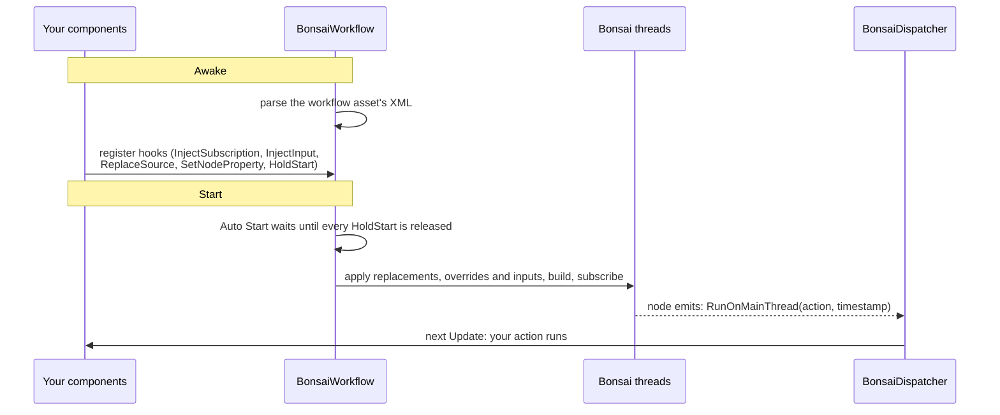

# Hook API

[README](../README.md) › Hook API

**This page is for programmers.** If you just want something to work, use the ready-made scripts in [Recipes](Recipes.md).

Every way Unity talks to a running workflow. The code is [`BonsaiWorkflow.cs`](../BonsaiInterface/Assets/Bonsai/BonsaiWorkflow.cs); traps are in [Gotchas](Gotchas.md).

## Lifecycle



Rules that apply to every hook:

- **Register in `Awake`.** The workflow starts in `BonsaiWorkflow.Start`, and Unity doesn't order different components' `Start` calls. Hooks registered after the workflow starts are ignored.
- **Top level by default; groups with `groupPath`.** `InjectSubscription`, `InjectImmediateSubscription`, `SendToSubject`, `ReplaceSource` and `SetNodeProperty` take an optional `groupPath` to reach nodes inside a `GroupWorkflow` (see [Hooks inside groups](#hooks-inside-groups)). Nodes inside a `SelectMany` or other nested workflow that is rebuilt per value can't be reached. Route what you need into a subject outside it.
- **Names are display names**: a subject's `Name`, an externalized property's `DisplayName`, or otherwise the label the Bonsai editor shows on the node (`IntProperty` shows as `Int`, for example).
- A hook that matches nothing logs a warning (or an error, for `SetNodeProperty`) when the workflow starts; the workflow still runs.

## `InjectSubscription`: Bonsai to Unity

```csharp
void Awake()
{
    var workflow = GetComponent<BonsaiWorkflow>();
    workflow.InjectSubscription("TimerOutput", typeof(Bonsai.Reactive.PublishSubject),
        (value, timestamp) => { /* runs on Unity's main thread */ });
}
```

| Argument | Meaning |
|---|---|
| `targetNode` | The node's display name. |
| `targetType` | The node's **exact** deserialized type, matched with `GetType() ==`. Required, see below. |
| `action` | `Action<object>`, or `Action<object, long>` to also get the emission time. |
| `groupPath` | Optional. Null for the top level, or a group's display name (`/` between nested groups). See [Hooks inside groups](#hooks-inside-groups). |

The action runs on Unity's main thread at the start of the next `Update` or `LateUpdate` after the node emits, whichever comes first, via `BonsaiDispatcher` (it runs before other scripts). For a handler that can't wait for the frame, see [`InjectImmediateSubscription`](#injectimmediatesubscription-bonsai-to-unity-at-once). The `long` is a `System.Diagnostics.Stopwatch` timestamp (QueryPerformanceCounter ticks on Windows) taken **on Bonsai's thread at the moment of emission**, so it is not delayed by the frame. Convert with `Stopwatch.Frequency`. Log the raw ticks if you need to align with other clocks later.

**Unbox defensively.** Values arrive boxed as `object`. The dispatcher catches and logs an exception from one action, so the other actions queued in that frame still run, but the failed handler did nothing. Check the type (`if (value is int port)`) and log and skip anything else.

### Which type to pass

Several nodes often share a name: a `PublishSubject` and every `SubscribeSubject` that reads it, for example, and a `SubscribeSubject` may come first in the file. Without the right type the hook binds the wrong node. Look up the node's `xsi:type` in the `.bonsai` XML:

| In the XML | Type to pass |
|---|---|
| `xsi:type="rx:PublishSubject"` | `Bonsai.Reactive.PublishSubject` |
| `xsi:type="rx:BehaviorSubject"` | `Bonsai.Reactive.BehaviorSubject` |
| `xsi:type="rx:ReplaySubject"` | `Bonsai.Reactive.ReplaySubject` |
| `xsi:type="rx:Condition"` | `Bonsai.Reactive.Condition` |
| `xsi:type="GroupWorkflow"` | `Bonsai.Expressions.GroupWorkflowBuilder` |
| `xsi:type="SubscribeSubject"` | `Bonsai.Expressions.SubscribeSubject` |
| `xsi:type="Combinator"` | `Bonsai.Expressions.CombinatorBuilder` |
| `xsi:type="PublishSubject"` (no prefix: Bonsai 2.6/2.7 files) | `Bonsai.Expressions.PublishSubjectBuilder` (obsolete; re-save the file instead) |

Subscribing to a subject is usually what you want: name the stream in Bonsai, and subscribe to that name.

## `InjectImmediateSubscription`: Bonsai to Unity, at once

```csharp
workflow.InjectImmediateSubscription("TrialStart", typeof(Bonsai.Reactive.BehaviorSubject),
    (value, timestamp) => { latestPort = (int)value; /* volatile field */ });
```

Same arguments as `InjectSubscription` with the timestamp. The action runs **on Bonsai's thread, as the node emits**, with no wait for the frame. Use it for the few handlers where that wait matters, such as starting a sound.

- It must be quick and must **not call the Unity API** (transforms, components, materials, UI). `Debug.Log` is allowed.
- Set a `volatile` field, write to a lock-free buffer, or call `BonsaiDispatcher.RunOnMainThread` for the part that needs Unity.
- It runs inside the workflow, so a slow action delays the node's other subscribers.

## `SendToSubject<T>`: Unity to Bonsai, by subject

In the workflow, declare a typed subject (a `BehaviorSubject` or `PublishSubject` source with a type and no input) with a name such as `UnityCueOnset`, and put a `SubscribeSubject` of that name wherever the value is needed. In Unity:

```csharp
private readonly UnitySignal<int> cueOnset = new UnitySignal<int>();

void Awake()
{
    GetComponent<BonsaiWorkflow>().SendToSubject(cueOnset, "UnityCueOnset");
}

// later, from any thread
long sentTicks = cueOnset.Send(armedPort);
```

- `UnitySignal<T>` is a `Source<T>` Unity fires by hand. `Send` pushes the value into the workflow **now, on the calling thread**, with no queue and no frame of delay, and returns the `Stopwatch` timestamp taken just before, for logging. It is safe from any thread.
- At start `BonsaiWorkflow` adds two nodes next to the subject's declaration, a source for the signal and a `MulticastSubject` (the node Bonsai uses to push into a subject by name). The workflow file is untouched, and opened in Bonsai alone the subject is just silent.
- A missing subject logs an error and the rest of the workflow runs without the signal. A subject whose type differs from the signal's makes the workflow fail to build.
- Downstream nodes run on the thread that called `Send` until the workflow moves on (`ObserveOn`, `Delay`), so a slow branch fed from the main thread stalls the frame.

## `InjectInput<T>`: Unity to Bonsai

```csharp
workflow.InjectInput(mySource, "IntInput");
```

Replaces the `ExternalizedMapping` node with that display name by a `PropertyMapping` fed from `mySource`, a `Bonsai.Source<T>`, so each value the source emits sets the externalized property. The target is resolved when the workflow starts. The `InputTest` sample's `IntegerSource` shows how to write a source driven from `Update`.

## `ReplaceSource<T>`: swap a node for a Unity source

```csharp
workflow.ReplaceSource("Bonsai.Windows.Input.KeyDown", myKeySource, "Ctrl-J for Juice");
```

Replaces every top-level node whose combinator type's **full name** is `targetTypeName` **and** that feeds a node with display name `successorName`, by `replacement`. Matching by name means Unity needn't reference the type: `KeyDown` emits `System.Windows.Forms.Keys`, which Unity scripts can't use. Downstream nodes must accept `T`. The successor name picks one node when a workflow has several of the same type; give that successor (often a group) a clear name in Bonsai.

Use it for nodes that don't work inside Unity, such as `KeyDown` (see [Gotchas](Gotchas.md#keydown-never-fires-inside-unity)), or to drive part of a workflow from the game.

## `SetNodeProperty`: override a property at start

```csharp
workflow.SetNodeProperty("Bonsai.IO.CsvWriter", "FileName", Path.Combine(logFolder, "bonsai.csv"));
workflow.SetNodeProperty("Bonsai.IO.CsvWriter", "Suffix", "None");
```

Sets a property on **every** top-level node of that type (combinator nodes are matched on the combinator they wrap). Enum values can be given by name, so callers don't need the enum type. If the type has no settable property of that name, it logs an error at start. That error is also the symptom of the node's DLL being missing: the node loaded as an empty proxy (see [Checking the DLLs](../README.md#checking-the-dlls)).

## Hooks inside groups

```csharp
workflow.InjectSubscription("HarpTimestamp", typeof(Bonsai.Reactive.BehaviorSubject), OnEdge, "HARP");
workflow.SetNodeProperty("Bonsai.IO.CsvWriter", "FileName", harpCsvPath, "HARP");
```

- `groupPath` is a group's display name, with `/` between nested groups (`"HARP/Markers"`). Null or empty means the top level.
- With a path, the hook searches that group's nodes **and any groups nested inside it**. Disabled groups are skipped.
- Only `GroupWorkflow` is entered. `SelectMany` and `CreateObservable` inner workflows are built again for each element, so a subscription there never fires and a property set there is lost.
- A path that doesn't resolve logs a warning naming the missing group. If more than one node matches an `InjectSubscription`, it binds the first and warns, so keep subject names unique.
- **Fallback search.** If `InjectSubscription` or `ReplaceSource` finds nothing where its `groupPath` says (including the top level when it has none), it searches the whole workflow, uses the matches in the first group that has any, and warns with the `groupPath` to put in the call. A workflow regrouped in Bonsai keeps working, and the warning tells you what to change.
- `SetNodeProperty` has **no fallback**. It changes every match, so a workflow-wide search could redirect a second `CsvWriter` as well.
- A group path picks between nodes that share a type name (two `CsvWriter`s, say), since nodes without a `Name` show their type name and a name can't tell them apart.

## `HoldStart` / `ReleaseStart`: delay Auto Start

```csharp
void Awake()  { workflow.HoldStart(this); }
void OnLogReady() { workflow.ReleaseStart(this); }
```

Auto Start waits until every holder has released. Use it when something must be ready before the workflow emits, for example a log folder for `SetNodeProperty` to point at. If the last release comes after `Start`, the workflow starts right then, on the caller's thread (call it from the main thread). A hold that is never released means the workflow never starts.

## `GetExternalizedTimeSpan`: read a duration from the workflow

```csharp
TimeSpan cooldown = workflow.GetExternalizedTimeSpan("Cooldown");
```

Finds the `ExternalizedMapping` with that display name and returns the `DueTime` of the node it feeds (`Delay`, `Timer`, `DelaySubscription`), as saved in the workflow. Useful to show a countdown in Unity that matches the workflow without copying the number. Call it from `Start` or later. Renaming the mapping, or connecting it to a node without a `TimeSpan DueTime`, makes it log an error and return zero. It reads `DueTime` only; other properties need a new method.

## `StartWorkflow`, `Restart`, `StopWorkflow` and events

```csharp
workflow.StartWorkflow();   // with Auto Start off; register every hook first
workflow.Restart();         // stop, parse the asset again, start
workflow.StopWorkflow();    // dispose: closes serial ports and other devices
bool running = workflow.IsRunning;
```

`IsRunning` is true from the start until the workflow completes, fails or is stopped. **Bonsai Workflow** also has three `UnityEvent`s, raised on the main thread and wired in the Inspector or with `AddListener`:

| Event | Raised when |
|---|---|
| `Started` | the workflow has started |
| `Completed` | every source in the workflow has finished (not after `StopWorkflow`) |
| `OnError(string)` | a node fails while building or running; the argument is that node's display name, or `""` if Bonsai doesn't name one |

An error ends the running workflow, so `Restart()` is the way to run it again; `StartWorkflow` on a workflow that already ran logs an error and does nothing, because building changes the graph. Hooks registered in `Awake` are applied again by `Restart`. `StopWorkflow` is safe to call when it never started or has already stopped; `OnDestroy` calls it. Whether the workflow survives a failure is the workflow's business (`Catch`, `Retry`); these events only report it.

## Threads

- Bonsai emits on its own threads. Never call the Unity API from inside a `Source<T>` or other Bonsai-side code; `InjectSubscription` actions are already moved to the main thread.
- `BonsaiDispatcher` creates its own `Dispatcher` GameObject before the first scene loads (`DontDestroyOnLoad`), so it needs no setup. It runs queued actions in order at the start of `Update` and of `LateUpdate`, before other scripts, catches and logs each action's exception on its own, and clears its queue when Play starts (so events left over from the last Play session aren't delivered to the new one).
- Workflow errors are logged with `Debug.LogError` on the main thread and raised as the `OnError` event. By Rx rules the branch that failed has ended (see [Gotchas](Gotchas.md#an-error-stops-that-branch)).
